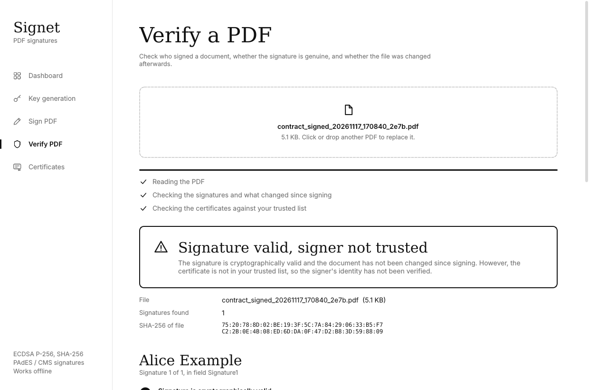

# Signet: ECDSA PDF digital signatures

A desktop program (not a website) that signs and verifies PDF documents with real
cryptography: **ECDSA on the P-256 curve, SHA-256 digests, X.509 certificates and
CMS/PAdES signatures**. Everything happens on your computer. There is no server and
nothing is sent over the internet.



## Getting the .exe (Windows)

An `.exe` has to be built on Windows. Do this once:

1. Install **Python 3.10 or newer (64-bit)** from python.org. Tick *Add python.exe to PATH*.
2. Double-click **`build_exe.bat`** in this folder and wait a few minutes.
3. Your program is **`dist\Signet.exe`**. It is a single file; copy it anywhere.

The first launch may be slow (it unpacks itself), and Windows SmartScreen may warn about an
unknown publisher, because the program is not code-signed. Choose *More info*, then *Run anyway*.

Keys, certificates and signed PDFs are stored in `Documents\ECDSA PDF Signer`.

### Running without building an .exe

```
pip install -r backend/requirements.txt
python main.py
```

## Using it

| Page | What it does |
|---|---|
| Dashboard | Counts of signed and verified documents, recent activity, quick actions |
| Key generation | Creates an ECDSA P-256 key pair and a self-signed X.509 certificate. Click an identity to open its details, export files, trust or delete it |
| Sign PDF | Drop a PDF, pick an identity, enter its password, click **Sign document**, then save the signed copy |
| Verify PDF | Drop a signed PDF. Shows four separate answers: valid signature, changed after signing, certificate valid today, certificate trusted |
| Certificates | Your certificates, the certificates you trust, and a button to trust someone else's certificate (PEM file) |

## The cryptographic workflow

**Key generation.** `cryptography` creates a P-256 private key. The private key is saved in
PKCS#8 PEM format, encrypted with your password (the library's best available encryption), with
file permissions limited to your user. A self-signed X.509 v3 certificate is created for the public
key (SHA-256 with ECDSA, key usage *digital signature* and *non-repudiation*, not a CA).
Only a password-protected key can be exported, and only in encrypted form.

**Signing.** pyHanko appends the signature to the PDF as an *incremental update*, so every byte
of the original stays exactly as it was and the original file on disk is never modified.
1. pyHanko hashes the whole file except the space reserved for the signature, using SHA-256.
2. It builds a CMS `SignedData` structure with signed attributes (content type, message digest and
   the signing certificate hash) and signs those attributes with ECDSA using your private key.
3. The structure, which includes your certificate, is written into the PDF with sub-filter
   `ETSI.CAdES.detached` (PAdES baseline).
4. Signet then verifies the new signature before saving it, and saves it as a *new* file.

**Verifying.** pyHanko recomputes the SHA-256 digest over the signed byte ranges, checks it against
the digest in the signature, checks the ECDSA signature with the certificate's public key, and
analyses any revisions appended after the signature. Signet then reports separately:

1. **Signature valid?** The mathematics works out.
2. **Changed after signing?** Nothing, only permitted additions (such as another signature), or
   a change the signature does not allow.
3. **Certificate valid today?** Inside its validity dates.
4. **Certificate trusted?** Only if the certificate, or the one that issued it, is in *your* trusted list.
5. **Revoked?** Reported honestly as *not checked*. Signet works offline.

### Self-signed versus authority-issued certificates

A certificate says "this public key belongs to this name". In a self-signed certificate the owner
vouches for themselves, so anyone can make one with any name. A certificate from a certificate
authority was signed after the authority checked who the owner is. Signet therefore never calls a
signer trusted just because the signature maths works: a valid signature from an unknown
self-signed certificate is shown as **valid, signer not trusted**. To trust a signer, get their
certificate fingerprint from them directly, then use *Trust this certificate*.

## Security notes

- Private keys are never shown on screen and are never put in the program's code.
- Private keys are stored without a password only if you tick the explicit box. Such a key cannot be exported.
- Passwords must be at least 12 characters. Uploaded files are checked: size limit 25 MB, must be a
  readable PDF, password-protected PDFs are refused.
- The original PDF is never overwritten; signed copies get a new timestamped name.
- Malformed certificates, damaged PDFs and invalid signatures produce clear messages, not crashes.

## Limitations (please read)

- Signatures are **invisible**: they appear in the signature panel of PDF readers such as Adobe
  Acrobat, not as a stamp on the page.
- No trusted timestamp. The signing time shown is what the signer's computer claimed.
- No revocation checking (CRL/OCSP) and no long-term validation data. No PAdES-LT/LTA profile.
- Password-protected (encrypted) PDFs are not supported.
- Adobe Acrobat will also show a self-signed signer as unknown until its certificate is added to
  Acrobat's own trusted list. This is the same distinction described above.

## Project layout

```
main.py                    starts the program
build_exe.bat / .sh        builds the single-file program
backend/                   all cryptography and PDF work (no user interface code)
  key_generator.py           ECDSA P-256 keys, PEM, password protection
  certificate_generator.py   X.509 certificates and the details shown on screen
  pdf_signer.py              CMS/PAdES signing with pyHanko
  pdf_verifier.py            signature, change, certificate and trust checks
  trust_store.py             the list of certificates you trust
  identity_storage.py        saves and loads identities (keys/ and certificates/)
  activity_log.py            counts and recent activity for the dashboard
  pdf_checks.py              validates uploaded PDFs
  folders.py                 where files are stored
  demo.py, self_test.py, sample_pdf.py    demonstration and checks
gui/                       the windows (PySide6)
test_gui.py                clicks through the real window and checks the results
demo_output/               a real signed PDF and tampered copies from demo.py
screenshots/               pictures of every screen
```

## Demonstration and tests

```
cd backend
python demo.py             signs a PDF, verifies it, tampers with it, verifies again
cd ..
python test_gui.py         84 checks that drive the real window (runs without showing it)
python main.py --self-test signs and verifies a PDF without opening a window
```

`demo_output/sample_signed.pdf` opens in any PDF reader. `sample_signed_TAMPERED_content.pdf` has one
word changed inside the signed area, and the signature shows as invalid. The files were also checked with
the independent tool `pdfsig` (poppler): the signed file reports *Signature is Valid*, the tampered one *Digest Mismatch*.
"# ecdsa_pdf_signer" 
